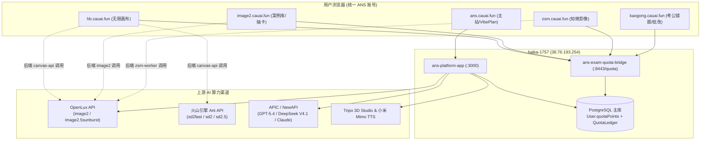

# ANS (AI Never Stops) 全站服务器拓扑、域名路由与运维急救手册

> **文档版本**：`v1.0-prod`（2026-10-20 生产环境实盘核定版）  
> **维护主体**：ANS (`AI Never Stops`) 核心工程与运维团队  
> **关联账本总表**：[《ANS 全站积分定价、成本核算与毛利率总表》](https://narcb9vct6.feishu.cn/wiki/OcX7wkPaYiOrPdkevmFcSaqBnbg)  
> **核心原则**：全站 100% 统一使用 ANS 账户（OIDC）与算力积分账本（PostgreSQL `User.quotaPoints` + `QuotaLedger`），所有子站通过 `ans-exam-quota-bridge` (`haika-1757:8443`) 进行 HMAC 签名预扣与结算。

---

## 一、 3 台核心生产服务器总览

| 服务器 SSH 别名 | 公网 IP | 角色定位 | 运行的核心站点与基础设施服务 |
| :--- | :---: | :--- | :--- |
| **`haika-1757`** | `38.76.193.254` | **ANS 主站 + 积分桥中枢 + 无限画布 + 3D Worker** | 1. `ans.cauai.fun`（ANS 主站 `ans-platform-app` Docker 容器）<br>2. `hb.cauai.fun`（无限画布 `canvas-api` + `canvas-web` Docker 容器）<br>3. `sites.cauai.fun`（3D 个人网站托管服务）<br>4. `ans-exam-quota-bridge.service`（`:8443` 跨站统一积分结算网关）<br>5. `ans-production-3d-worker`（Tripo 3D 异步生成 Worker）<br>6. PostgreSQL 主数据库（承载全站账号、积分账本、市场订单） |
| **`kaogong`** | 生产节点 B | **知微影像 (`zsm`) + 考公 AI (`kaogong`)** | 1. `zsm.cauai.fun`（知微影像 `zsm-shoot-web.service` `:4196` + `zsm-shoot-worker.service`）<br>2. `kaogong.cauai.fun`（考公智能错题本与申论批改 `kaogong-wrongbook.service` + `ans-sites-oidc.service` `:8151`） |
| **`haika-niannian`** | 生产节点 C | **Image2 提示词案例库与抽卡工坊 (`image2`)** | 1. `image2.cauai.fun`（Next.js 生产服务 `:3011`，含案例库、多图对比工作台、盲盒抽卡 Gacha） |

---

## 二、 7 大官方生产域名与路由映射全景表

| 序号 | 生产域名 | 所属服务器 | 前端/反向代理层 | 后端监听端口与进程形态 | 服务器源码与配置绝对路径 | 积分扣费对接方式 |
| :---: | :--- | :---: | :--- | :--- | :--- | :--- |
| **1** | **`https://ans.cauai.fun`**<br>*(ANS 官方主站)* | `haika-1757` | Host Nginx / Proxy -> `:3000` | Docker 容器 `ans-platform-app`<br>(Next.js 15 App Router) | 宿主机发布包：`/srv/ans-releases/ans-bd8876f3-20261017/source/`<br>容器内路径：`/app/`<br>私有配置：`/srv/ans-releases/ans-bd8876f3-20261017/production-private.json` | 直连主库 PostgreSQL `User.quotaPoints` + `QuotaLedger` |
| **2** | **`https://hb.cauai.fun`**<br>*(无限画布 AIGC 工作台)* | `haika-1757` | Docker `canvas-web` -> `canvas-api:8790` (宿主机 `:8788`) | Docker 容器：`canvas-api` (`:8790`) + `canvas-web` | 宿主机后端：`/opt/infinite-canvas/api/`<br>容器内后端：`/app/` (`ziyu.js`, `credits.js`, `routes-credits.js`, `unified-quota.js`)<br>宿主机前端产物：`/opt/infinite-canvas/current/dist/` | `unified-quota.js` -> `https://127.0.0.1:8443/quota` (`ans-exam-quota-bridge`) |
| **3** | **`https://image2.cauai.fun`**<br>*(Image2 案例库与抽卡)* | `haika-niannian` | `/etc/nginx/sites-enabled/image2.cauai.fun` -> `127.0.0.1:3011` | Node `next-server` (`:3011`) | 源码与产物：`/opt/image2-cauai/`<br>环境配置：`/opt/image2-cauai/.env.local`<br>核心计费：`/opt/image2-cauai/lib/image2-wallet.ts` | `image2-wallet.ts` -> `https://38.76.193.254:8443/quota` (`ans-exam-quota-bridge`) |
| **4** | **`https://zsm.cauai.fun`**<br>*(VibePhoto 知微影像)* | `kaogong` | `/etc/nginx/sites-available/zsm.cauai.fun` -> `127.0.0.1:4196` | Systemd 服务：<br>`zsm-shoot-web.service` (`:4196`)<br>`zsm-shoot-worker.service` | 源码与产物：`/var/www/zsm-photo-shoot/current/`<br>核心计费：`runtime/access.mjs`、`runtime/provider.mjs`、`runtime/accounts.mjs` | `runtime/access.mjs` -> `https://38.76.193.254:8443/quota` (`ans-exam-quota-bridge`) |
| **5** | **`https://kaogong.cauai.fun`**<br>*(考公备考与智能错题本)* | `kaogong` | `/etc/nginx/sites-available/kaogong.cauai.fun` | Systemd 服务：<br>`kaogong-wrongbook.service`<br>`ans-sites-oidc.service` (`:8151`) | OIDC 桥与计费组件：`ans-quota.js`、`analysis-pricing.js` | `ans-quota.js` -> `https://38.76.193.254:8443/quota` (`ans-exam-quota-bridge`) |
| **6** | **`https://resume.cauai.fun`**<br>*(个人简历与作品集展示)* | `haika-1757` | 静态托管 / 反向代理 | 纯静态站点 + 跳转主站工作流 | 站内按钮直跳 `https://ans.cauai.fun/workflows/ans-portfolio-website` | 跳转 ANS 主站工作流统一扣费（3 积分/次） |
| **7** | **`https://video.cauai.fun`**<br>*(AI 商业视频服务目录)* | `haika-1757` | 静态托管 / Cloudflare | 纯静态样片展示页 | 商业定制展示，自助生成统一引导至 `https://hb.cauai.fun/video` | 自助视频生成在 `hb.cauai.fun` 统一扣费 |

---

## 三、 跨站统一账户与积分结算桥 (`ans-exam-quota-bridge`) 架构

### 1. 通信拓扑图



### 2. 标准三段式扣费状态机（防白嫖 / 防吞币铁律）
所有子站在发起上游 AI 调用前，必须严格执行以下 3 步：
1. **预扣冻结 (`operation: "reserve"`)**：
   - 请求前校验用户登录态（未登录直接返回 `401/402`），并按实际请求张数/秒数向 `:8443/quota` 发起 `reserve`（生成唯一 `requestId`）。
   - 余额不足立即中断，绝不向上游发起请求。
2. **执行生成与真实回执核算 (`operation: "settle", ok: true`)**：
   - 上游成功返回图像/视频/批改结果后，调用 `settle(requestId, actualPoints, ok: true)` 完成实扣落账。
3. **异常兜底全额退回 (`operation: "settle", ok: false, actualPoints: 0`)**：
   - 若上游返回 4xx/5xx、超时或内容审核拦截，捕获异常并立即调用 `settle(requestId, 0, ok: false)`（或 `refundQuota`），将预扣积分 100% 原路退回 `User.quotaPoints`。

---

## 四、 日常运维速查与急救命令手册（SOP）

### 1. ANS 主站 (`ans.cauai.fun` @ `haika-1757`)
- **查看容器状态与最近日志**：
  ```bash
  ssh haika-1757 "docker ps --filter name=ans-platform-app && docker logs --tail 100 ans-platform-app"
  ```
- **重启主站服务**：
  ```bash
  ssh haika-1757 "docker restart ans-platform-app"
  ```
- **修改私有环境变量配置（如模型倍率、Tripo 单价）**：
  - 编辑 `/srv/ans-releases/ans-bd8876f3-20261017/production-private.json`，通过发布脚本重建或注入容器环境变量后重启。

### 2. 无限画布 AIGC 工作台 (`hb.cauai.fun` @ `haika-1757`)
- **查看后端 API 容器日志**：
  ```bash
  ssh haika-1757 "docker logs --tail 100 canvas-api"
  ```
- **同步宿主机代码至容器并热重启**：
  ```bash
  ssh haika-1757 "docker cp /opt/infinite-canvas/api/ziyu.js canvas-api:/app/ziyu.js && docker restart canvas-api"
  ```
- **核验模型列表与积分倍率接口**：
  ```bash
  curl -s https://hb.cauai.fun/api/ziyu/models | jq .
  curl -s https://hb.cauai.fun/api/credits/config | jq .
  ```

### 3. Image2 提示词案例库与抽卡 (`image2.cauai.fun` @ `haika-niannian`)
- **查看运行进程与端口 (`:3011`)**：
  ```bash
  ssh haika-niannian "ps aux | grep next-server && ss -tlnp | grep 3011"
  ```
- **修改代码后重新编译并平滑重启**：
  ```bash
  ssh haika-niannian "cd /opt/image2-cauai && npm run build && fuser -k 3011/tcp; nohup npx next start -p 3011 > /var/log/image2-next.log 2>&1 &"
  ```
- **核验匿名配额封堵与抽卡配置**：
  ```bash
  curl -s https://image2.cauai.fun/api/image2/quota
  curl -s https://image2.cauai.fun/api/image2-gacha/config
  ```

### 4. 知微影像 (`zsm.cauai.fun` @ `kaogong`)
- **查看 Systemd 服务状态与日志**：
  ```bash
  ssh kaogong "systemctl status zsm-shoot-web zsm-shoot-worker && journalctl -u zsm-shoot-web -n 80 --no-pager"
  ```
- **重新编译并重启服务**：
  ```bash
  ssh kaogong "cd /var/www/zsm-photo-shoot/current && npm run build && systemctl restart zsm-shoot-web zsm-shoot-worker"
  ```

### 5. 考公智能错题本与 OIDC 桥 (`kaogong.cauai.fun` @ `kaogong`)
- **查看服务状态与重启**：
  ```bash
  ssh kaogong "systemctl status kaogong-wrongbook ans-sites-oidc && systemctl restart kaogong-wrongbook ans-sites-oidc"
  ```

### 6. 全站积分结算桥 (`ans-exam-quota-bridge` @ `haika-1757`)
- **查看积分桥健康状态与日志**：
  ```bash
  ssh haika-1757 "systemctl status ans-exam-quota-bridge && journalctl -u ans-exam-quota-bridge -n 80 --no-pager"
  ```
- **緊急重启积分桥**：
  ```bash
  ssh haika-1757 "systemctl restart ans-exam-quota-bridge"
  ```
